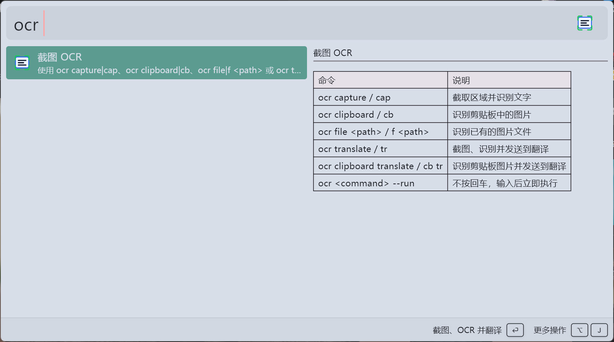

# Screenshot OCR

[English](README.en.md) | [中文](README.md)

> This plugin is still in beta and has not been fully tested. Sorry in advance for serious bugs; please report them through [GitHub Issues](https://github.com/stmluyuer/Wox.Plugin.ScreenshotOCR/issues), and I will fix them as soon as I can.

Screenshot OCR is a [Wox](https://github.com/Wox-launcher/Wox) plugin for recognizing text from screenshots, clipboard images, or image files. It can work with [LuxTranslate](https://github.com/stmluyuer/Wox.Plugin.LuxTranslate) through the `tr` query prefix, so the common flow is:

```text
Screenshot -> OCR text recognition -> LuxTranslate -> target language
```

[Download the Windows beta](https://github.com/stmluyuer/Wox.Plugin.ScreenshotOCR/releases/latest) · [Report an issue](https://github.com/stmluyuer/Wox.Plugin.ScreenshotOCR/issues)



## Features

- `ocr capture` captures a screen region. The current source defaults to Wox Screenshot; Windows also has a built-in region selector.
- `ocr clipboard` reads an image from the clipboard and runs OCR.
- `ocr file <path>` recognizes an existing local image file.
- `ocr translate` captures, recognizes, and sends the result to LuxTranslate.
- Windows OCR without API setup through the bundled helper, with Snipping Tool and WeChat/QQ options for compatible bridge commands.
- Large model OCR through OpenAI-compatible vision models.
- Local deployment script for quick testing in `%USERPROFILE%\.wox\wox-user\plugins`.

## OCR Providers

The current settings expose these OCR options:

| Category     | Providers                                                   |
| ------------ | ----------------------------------------------------------- |
| No-setup OCR | Windows local OCR; compatible Snipping Tool and WeChat/QQ bridges |
| Vision LLM   | OpenAI-compatible vision model                              |

Notes:

- Windows OCR does not require an API key. The setting labeled “Windows App SDK local OCR” calls Windows Runtime OCR through the bundled helper and requires Windows 10/11 with the relevant OCR language support.
- The Snipping Tool and WeChat/QQ options run a compatible bridge command when configured. Without one, both fall back to the same bundled Windows OCR helper. Selecting these names alone does not connect to the applications' native OCR.
- Vision LLM OCR sends images to an OpenAI-compatible `chat/completions` endpoint. It requires a vision-capable model and API configuration; images are sent to the configured service.

The following describes the current `main` branch. The published v0.1.0 package supports Windows only:

| Capability | Windows | macOS / Linux (current source) |
| --- | --- | --- |
| Region capture | Wox Screenshot or built-in selector | Wox Screenshot; requires a Wox build with the Screenshot API |
| Clipboard images | Supported | Not implemented |
| Image files | Supported | Supported |
| OCR | Windows local OCR or vision LLM | Vision LLM; configure a service first |
| Skip confirmation after selection | Built-in selector | Not supported |

## Installation

On Windows, download `wox.plugin.screenshotocr.wox` from [GitHub Releases](https://github.com/stmluyuer/Wox.Plugin.ScreenshotOCR/releases/latest) and open it with Wox. The current release is [v0.1.0](https://github.com/stmluyuer/Wox.Plugin.ScreenshotOCR/releases/tag/v0.1.0), whose manifest requires Wox 2.0.0 or later.

To send recognized text to LuxTranslate, install it separately and use the same translation query prefix in both plugins (default: `tr`).

To build from source (the current branch includes the cross-platform changes above and needs Node.js, pnpm, and the .NET SDK to build the Windows OCR helper):

```bash
git clone https://github.com/stmluyuer/Wox.Plugin.ScreenshotOCR.git
cd Wox.Plugin.ScreenshotOCR
pnpm install
pnpm run build
pnpm run package
```

The build output is written to `dist/`. `pnpm run package` creates `wox.plugin.screenshotocr.wox` for GitHub Releases and Wox Store download URLs.

For local testing, run `pnpm run deploy` to copy `dist/` into the current user's Wox plugin directory, then reload Wox plugins.

## Usage

| Command                                         | Description                                      |
| ----------------------------------------------- | ------------------------------------------------ |
| `ocr`                                           | Show help                                        |
| `ocr capture` / `ocr cap`                       | Capture a screen region and run OCR              |
| `ocr clipboard` / `ocr cb`                      | Recognize the image currently in the clipboard   |
| `ocr file <path>` / `ocr f <path>`              | Recognize an existing image file                 |
| `ocr translate` / `ocr tr`                      | Capture a region, run OCR, and open LuxTranslate |
| `ocr clipboard translate` / `ocr cb tr`         | Recognize clipboard image and open LuxTranslate  |
| `ocr file <path> translate` / `ocr f <path> tr` | Recognize image file and open LuxTranslate       |

Append `--run`, `--go`, or `!` to any executable command to run it immediately after typing, without pressing Enter. Examples: `ocr tr --run` and `ocr cb tr --run`. You can also enable `Auto execute exact commands` in settings to auto-run complete commands.

Recommended Wox query hotkey:

- Query: `ocr translate`
- Silent execution: enabled

## Settings

- `Default command`: choose the default action in the help result.
- `Screenshot method`: the current source offers Wox Screenshot or the Windows built-in selector.
- `OCR service type`: Windows offers no-setup OCR or vision LLM OCR; the current source uses vision LLM OCR on macOS/Linux.
- `No-setup OCR provider`: choose the local OCR provider used in no-setup mode.
- `Auto translate after OCR`: send OCR results to LuxTranslate even for non-translation OCR commands.
- `Auto execute exact commands`: run complete OCR commands immediately after typing.
- `Skip confirm after selection`: Windows only. Use the built-in selector without its confirmation toolbar; enabling this also selects the built-in capture path in the current source.
- `Translate query prefix`: defaults to `tr`.
- `Request timeout`: timeout for vision LLM requests and local OCR bridge commands.
- `Large model OCR settings`: configure API key, base URL, and model in the provider table.

## Development

```bash
pnpm install
pnpm test
pnpm run build
pnpm run deploy
pnpm run package
```

Useful commands:

- `pnpm test`: run Jest tests.
- `pnpm run build`: run lint, format, compile the Windows OCR helper, and bundle the plugin into `dist/`.
- `pnpm run deploy`: copy `dist/` into the local Wox user plugin directory.
- `pnpm run package`: create `wox.plugin.screenshotocr.wox`.
- `pnpm run lint`: run ESLint.

## Workflow

1. Install the release package, or build and deploy the current source.
2. Configure a vision LLM provider if needed; the current macOS/Linux source requires one.
3. Run `ocr capture` to select a region, or `ocr file <path>` to recognize an existing image.
4. On Windows, you can also copy an image to the clipboard and run `ocr clipboard`.
5. Run `ocr translate` or `ocr clipboard translate` to hand the OCR text to LuxTranslate.

## Screenshots

- **Plugin settings page**: the Wox plugin settings panel.

  

- **Vision LLM OCR settings**: service configuration for OpenAI-compatible vision models.

  

## AI Collaboration Notice

This project was developed with substantial assistance from OpenAI Codex. The author is responsible for requirement design, code review, functional verification, and release decisions.

## License

MIT License. See [LICENSE](LICENSE).
