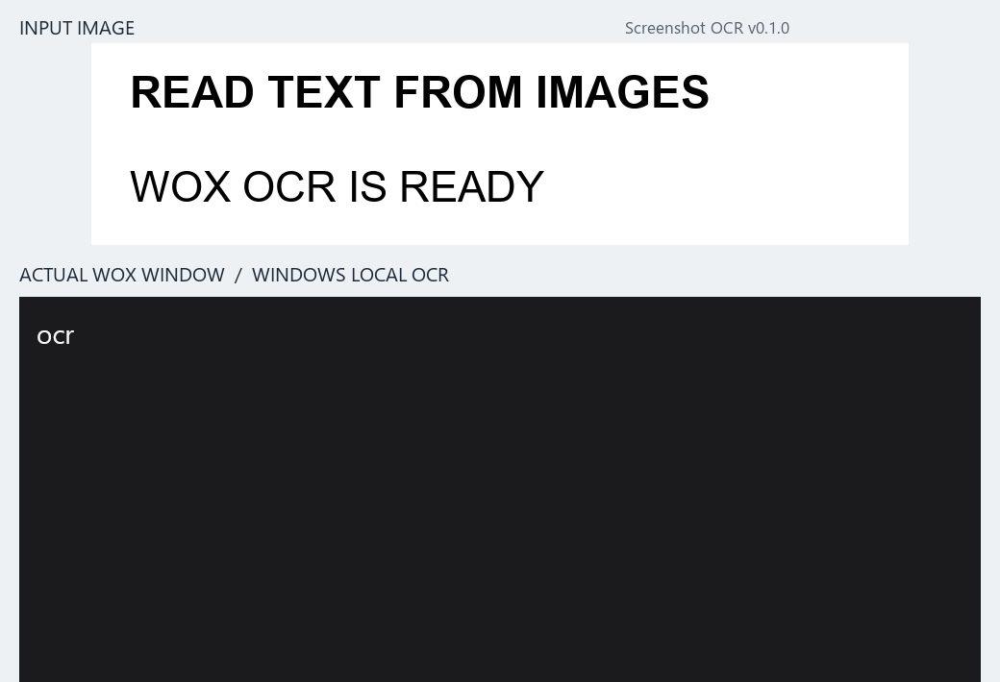
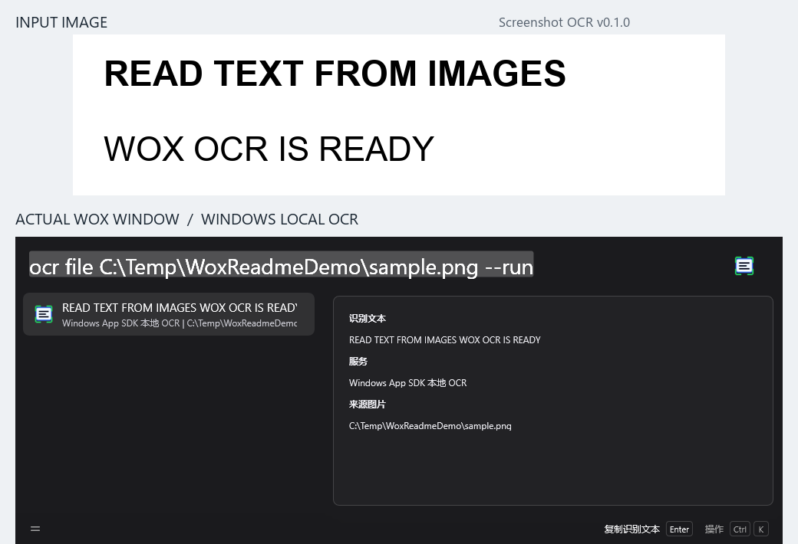
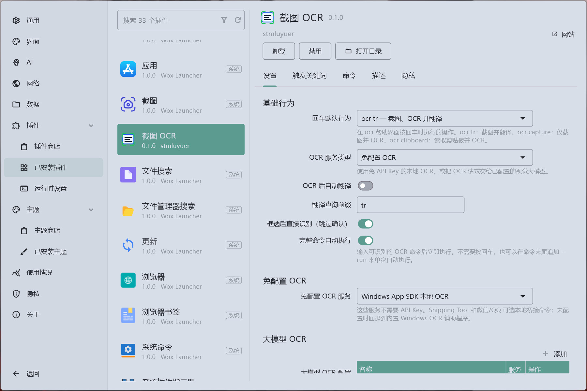
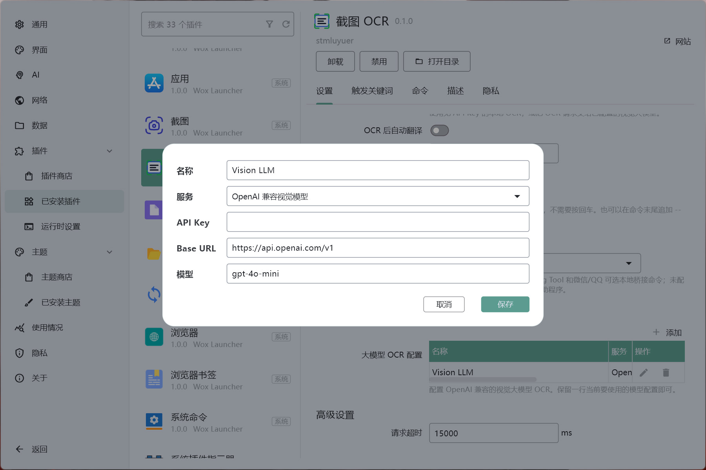

#  Screenshot OCR

[中文](README.md) | [English](README.en.md)

> 插件目前仍是测试版，尚未充分测试。遇到严重 bug 先说声抱歉，欢迎通过 [GitHub Issues](https://github.com/stmluyuer/Wox.Plugin.ScreenshotOCR/issues) 反馈，我会尽快修复。

Screenshot OCR 是一个面向 [Wox](https://github.com/Wox-launcher/Wox) 的截图 OCR 插件。支持截图、剪贴板图片和图片文件的文字识别，可与 [LuxTranslate](https://github.com/stmluyuer/Wox.Plugin.LuxTranslate) 通过 `tr` 查询前缀协同工作，典型流程为：

```text
截图 -> OCR 识别文字 -> LuxTranslate -> 目标语言
```

[下载 Windows 测试版](https://github.com/stmluyuer/Wox.Plugin.ScreenshotOCR/releases/latest) · [反馈问题](https://github.com/stmluyuer/Wox.Plugin.ScreenshotOCR/issues)



Wox v2.4.7 + Screenshot OCR v0.1.0 的 10 秒文件识别演示：输入 `ocr file C:\Temp\WoxReadmeDemo\sample.png --run`，使用 Windows 本地 OCR 识别并查看结果，无需 API Key。

<details>
<summary>查看识别结果对照</summary>



上方是[演示输入图片](screenshots/ocr-input.png)，下方是实际 Wox 识别结果。

</details>

## 功能

- `ocr capture` 截取屏幕区域；当前源码默认调用 Wox 截图，Windows 还可使用内置区域选择窗口。
- `ocr clipboard` 读取剪贴板中的图片并执行 OCR。
- `ocr file <path>` 识别本地已有图片文件。
- `ocr translate` 截图、识别并发送结果到 LuxTranslate。
- Windows 免配置 OCR：使用内置 Windows OCR 助手；Snipping Tool 和微信/QQ 选项可通过兼容桥接命令扩展。
- 大模型 OCR：支持 OpenAI 兼容视觉模型。
- 本地部署脚本，方便快速部署到 `%USERPROFILE%\.wox\wox-user\plugins` 测试。

## OCR 服务

当前设置提供以下 OCR 选项：

| 类别       | 服务                                                     |
| ---------- | -------------------------------------------------------- |
| 免配置 OCR | Windows 本地 OCR；Snipping Tool、微信/QQ 兼容桥接选项 |
| 大模型 OCR | OpenAI 兼容视觉模型                                      |

说明：

- Windows 免配置 OCR 不需要 API Key。设置中名为“Windows App SDK 本地 OCR”的选项使用内置助手调用 Windows Runtime OCR，需要 Windows 10/11 及相应的系统识别语言支持。
- Snipping Tool 和微信/QQ 选项配置兼容桥接命令后会调用该命令；未配置时，均回退到同一个 Windows OCR 助手。仅选择这些名称不会自动接入对应应用的原生 OCR。
- 大模型 OCR 使用 OpenAI-compatible `chat/completions` 接口，需要支持图片输入的模型及相应 API 配置，图片会发送到所配置的服务。

当前 `main` 分支的跨平台范围如下；已发布的 v0.1.0 包仅支持 Windows：

| 能力 | Windows | macOS / Linux（当前源码） |
| --- | --- | --- |
| 区域截图 | Wox 截图或内置选择窗口 | 需要提供 Screenshot API 的 Wox，使用 Wox 截图 |
| 剪贴板图片 | 支持 | 尚未实现 |
| 图片文件 | 支持 | 支持 |
| OCR | Windows 本地 OCR 或视觉大模型 | 视觉大模型，需要先配置服务 |
| 框选后跳过确认 | 内置选择窗口支持 | 不支持 |

## 安装

Windows 用户可从 [GitHub Releases](https://github.com/stmluyuer/Wox.Plugin.ScreenshotOCR/releases/latest) 下载 `wox.plugin.screenshotocr.wox`，在 Wox 中打开安装。当前发布版为 [v0.1.0](https://github.com/stmluyuer/Wox.Plugin.ScreenshotOCR/releases/tag/v0.1.0)，声明要求 Wox 2.0.0 或更高版本。

如需将识别结果交给 LuxTranslate，请另外安装该插件，并保持两者的翻译查询前缀一致（默认 `tr`）。

从源码构建（当前分支包含上述跨平台改动，需要 Node.js、pnpm 和用于构建 Windows OCR 助手的 .NET SDK）：

```bash
git clone https://github.com/stmluyuer/Wox.Plugin.ScreenshotOCR.git
cd Wox.Plugin.ScreenshotOCR
pnpm install
pnpm run build
pnpm run package
```

构建产物会生成在 `dist/`。`pnpm run package` 会生成 `wox.plugin.screenshotocr.wox`，用于 GitHub Releases 和 Wox Store 下载地址。

本地测试时可以运行 `pnpm run deploy`，将 `dist/` 部署到当前用户的 Wox 插件目录。

```bash
pnpm run deploy
```

部署后重新加载 Wox 插件即可。

## 使用

| 命令                                            | 说明                              |
| ----------------------------------------------- | --------------------------------- |
| `ocr`                                           | 显示帮助                          |
| `ocr capture` / `ocr cap`                       | 截取屏幕区域并 OCR                |
| `ocr clipboard` / `ocr cb`                      | 识别剪贴板中的图片                |
| `ocr file <path>` / `ocr f <path>`              | 识别已有的图片文件                |
| `ocr translate` / `ocr tr`                      | 截取区域、OCR 并打开 LuxTranslate |
| `ocr clipboard translate` / `ocr cb tr`         | 识别剪贴板图片并打开 LuxTranslate |
| `ocr file <path> translate` / `ocr f <path> tr` | 识别图片文件并打开 LuxTranslate   |

在任意可执行命令末尾追加 `--run`、`--go` 或 `!`，可以输入完成后立即执行，不需要按回车。例如 `ocr tr --run`、`ocr cb tr --run`。也可以在设置中开启 `完整命令自动执行`，让识别到的完整命令自动运行。

推荐 Wox 查询快捷键配置：

- 查询内容：`ocr translate`
- 静默执行：开启

## 配置

- `默认命令`：选择帮助结果中的默认操作。
- `截图方式`：当前源码可选择 Wox 截图或 Windows 内置选择窗口。
- `OCR 服务类型`：Windows 可选免配置 OCR 或大模型 OCR；当前源码在 macOS/Linux 上使用大模型 OCR。
- `免配置 OCR 服务`：选择免配置模式下使用的本地服务。
- `OCR 后自动翻译`：即使使用非翻译命令，也将 OCR 结果发送到翻译。
- `完整命令自动执行`：输入完整 OCR 命令后立即执行，不需要按回车。
- `框选后直接识别（跳过确认）`：仅 Windows 支持，使用内置选择窗口跳过确认工具栏；当前源码开启此项时也会切换到内置窗口。
- `翻译查询前缀`：默认为 `tr`。
- `请求超时`：大模型 OCR 调用和本地 OCR 桥接命令的超时时间。
- `大模型 OCR 配置`：在服务表格中配置 API Key、Base URL 和模型。

## 开发

```bash
pnpm install
pnpm test
pnpm run build
pnpm run deploy
pnpm run package
```

常用脚本：

- `pnpm test`：运行 Jest 测试。
- `pnpm run build`：运行 lint、format、编译 Windows OCR 助手，并打包插件资源到 `dist/`。
- `pnpm run deploy`：将 `dist/` 复制到 Wox 用户插件目录。
- `pnpm run package`：生成 `wox.plugin.screenshotocr.wox`。
- `pnpm run lint`：运行 ESLint。

## 工作流

1. 安装发布包，或构建并部署当前源码。
2. 如需使用大模型 OCR，先配置服务；macOS/Linux 当前源码必须配置。
3. 运行 `ocr capture` 截取区域，或运行 `ocr file <path>` 识别已有图片。
4. Windows 用户还可复制图片到剪贴板，运行 `ocr clipboard`。
5. 运行 `ocr translate` 或 `ocr clipboard translate` 将 OCR 文字交给 LuxTranslate。

## 截图

- **插件配置页面**：Wox 插件设置面板。

  

- **大模型 OCR 配置**：OpenAI 兼容视觉模型的服务配置。

  

## AI 协作声明

本项目由作者在 OpenAI Codex 协助下大量生成、重构和测试。作者负责需求设计、代码审阅、功能验证和发布决策。

## License

MIT License. See [LICENSE](LICENSE).
